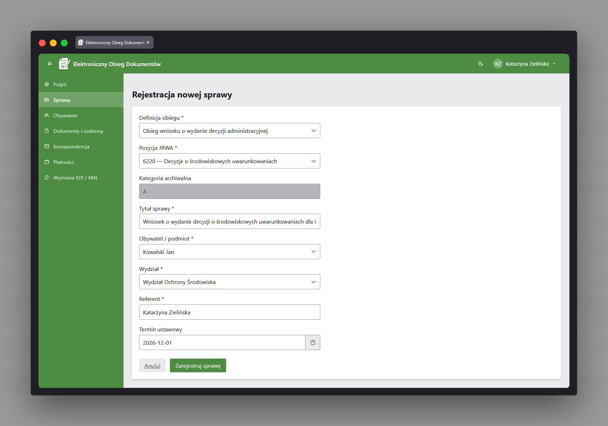
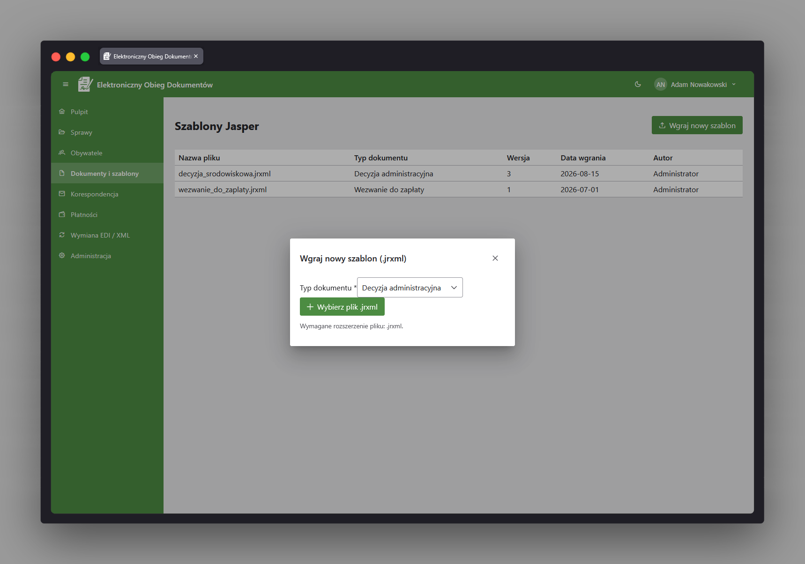
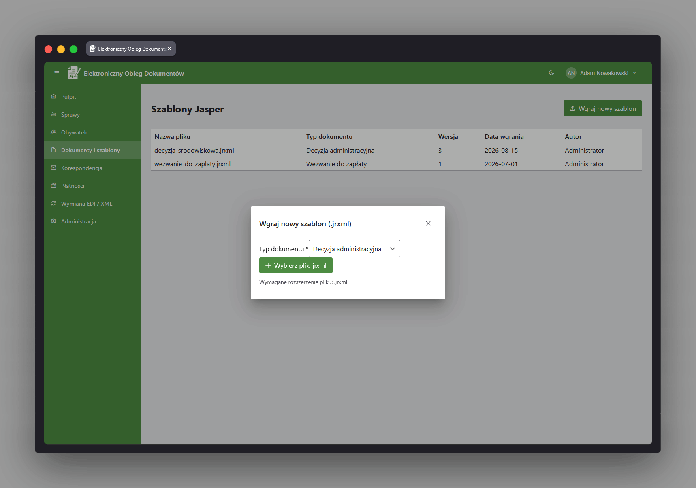
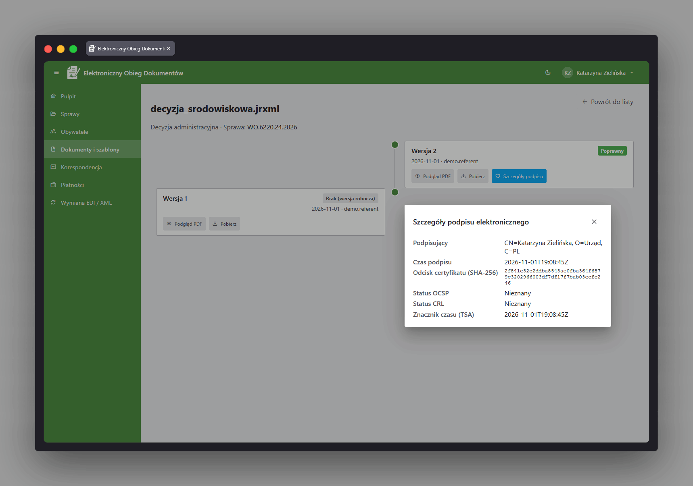
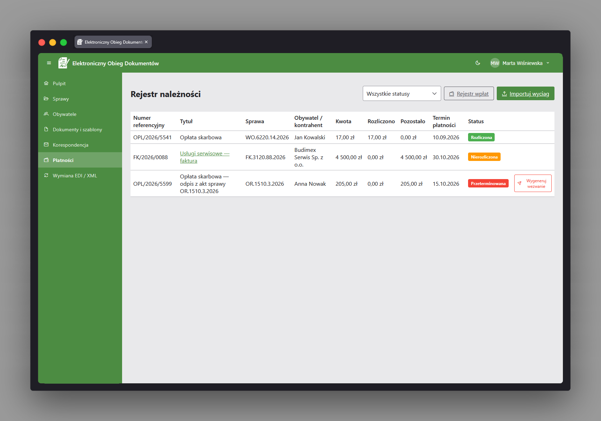
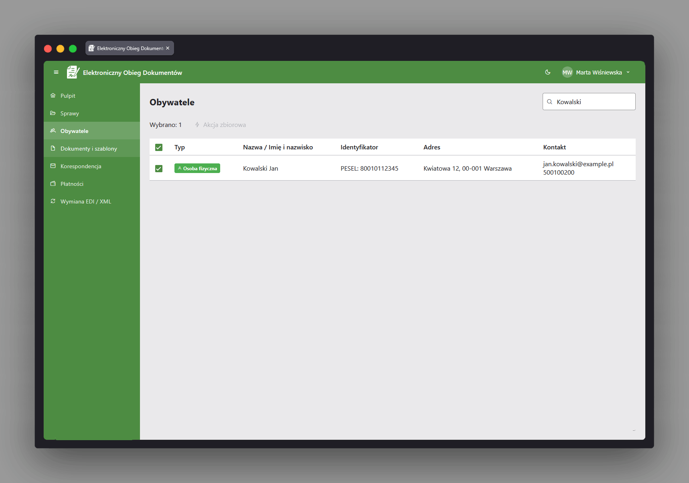

  

<h1 align="center">Electronic Document Workflow System</h1>

  
   
  

Enterprise-grade electronic document and case management system, modeled on EZD (Elektroniczne Zarządzanie Dokumentacją) systems used in Polish public administration. Built as a microservices architecture - a central case/document API, a dedicated DMS, a JasperReports rendering engine, an electronic signature service with its own demonstration PKI, a delivery simulator, Keycloak, and RabbitMQ - to mirror how a real administrative back office is split across specialized systems rather than one monolith.

## Document workflow standards used

- **JRWA** - Jednolity Rzeczowy Wykaz Akt (uniform records classification scheme) drives case reference numbers and archival category (A/B) assignment.
- **DMS (document management)** - versioned storage of document templates and generated documents, with a clear separation between draft (unsigned) and final (signed) versions of a document.
- **XAdES / PAdES (ETSI)** - electronic signing of PDF (PAdES) and XML (XAdES) documents using the EU DSS library, backed by a demonstration PKI (CA hierarchy, OCSP/CRL responder); XAdES is implemented in the signing service but not yet wired up end to end.
- **OIDC / OAuth2** - Keycloak as the identity provider; `document_api` validates JWTs as an OAuth2 resource server and maps realm roles to Spring Security authorities for role-based access control.
- **EZD architecture** - case register, case history (metryka sprawy), incoming/outgoing correspondence register, and audit logging follow the conventions of Polish EZD-class systems.
- **CAMT.053 (ISO 20022)** - bank statement import with real parsing of the standard structure and automatic matching of payments to receivables.
- **EDI/XML** - import of case messages (XML) and cost documents/invoices (UBL/PEPPOL) from external parties, with structural validation; currently import-only and without a live PEPPOL network connection.

## What EDWS does

- **Case and workflow management** - register cases under configurable workflow definitions (states, transitions, required roles/documents per type of matter), track case history, and enforce role- and document-based gating on state transitions.

- **Document and template management (DMS)** - upload and version JasperReports templates, generate documents from a template and case data, and browse the version history of a document, distinguishing draft (unsigned) from final (signed) versions.

- **Electronic signatures** - sign generated PDF documents with a user certificate, verify signature status (valid/invalid/expired/revoked) via OCSP/CRL, and inspect signature details including signer, timestamp, and certificate fingerprint.

- **Correspondence and dispatch** - send signed letters to citizens or organizations through e-Delivery, postal hybrid mail, or e-mail, and track delivery status (sent/delivered/received/returned) through an asynchronous status feed.

- **Payment reconciliation** - register receivables tied to a case, import bank statements to automatically match incoming payments, manually reconcile unmatched payments, and generate overdue payment reminders.

- **Citizen/entity card** - search citizens and organizations and view a unified profile covering their basic data, cases, documents, correspondence, and outstanding balances in one place.

- **EDI/XML exchange** - import case messages (XML) and cost documents/invoices (UBL/PEPPOL) from external parties, with structural validation and mapping into the domain model.
- **Bulk actions** - run bulk state changes, bulk letter dispatch, or bulk document generation across multiple cases asynchronously, with progress tracking.
- **User dashboard** - a landing page summarising open cases, upcoming/overdue statutory deadlines, unsettled receivables, and pending deliveries for the logged-in user.
- **Administration** - manage user profiles and roles, reference dictionaries (JRWA, document types, dispatch providers, fee rates), and review the audit log of operations on cases, documents, and payments.
